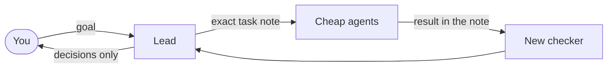

<p align="center"></p>

<h1 align="center">Homey</h1>

<p align="center"><b>Your agents forget. Your vault doesn't.</b></p>

Claude Code is brilliant until Tuesday, when it has forgotten Monday.

Homey gives it a memory you can read, a team that does the work, and one house rule: it only bothers you for decisions.

> **Early days.** One person runs this daily on three projects. Nobody else has installed it yet, so expect rough edges and [tell us](https://github.com/markelayan/claude-homey-obsidian/issues).

## You've been here

| The pain | What Homey does |
|---|---|
| **"That bug isn't related to my change."** Repeat until you have a thousand bugs nobody wrote down | Every agent is told to report any bug it sees, its fault or not. A fresh agent checks it, and it stays on the list until it's fixed |
| **"All tests pass, it's done."** Says the one who did the work | A new checker gets the work and the question, never the answer it's supposed to find |
| **You wake up and nothing moved.** One question stopped the whole night | A question blocks only its own task. The lead makes its pick and carries on; you overrule later |
| **"Please run this command for me."** | You're the boss, not the intern. Agents run the commands; you get the decisions |
| **New session, explain it all again.** | Rules, status and the next step are handed over at every start |
| **The one-line fix that became a refactor.** | A task names its exact files. Anything new goes on the bug list |
| **It looks busy. It stopped an hour ago.** | The watcher notices a quiet run and says so |
| **"Why did we do it this way?"** | Decisions are notes with their reason, not a chat you can't find |

## See it

<table><tr>
<td valign="top"></td>
<td valign="top"></td>
</tr><tr>
<td><b>Now.</b> What needs you. Often, nothing.</td>
<td><b>Bugs.</b> Every one written down, with its state.</td>
</tr></table>

<sub>Grey bars hide private project names.</sub>

## How it works



Everything lands in plain Markdown in your Obsidian vault. Homey adds no server and no database: just files you can read. Your prompts go only where Claude Code already sends them.

## Install

You need macOS, the Claude Code desktop app, [Obsidian](https://obsidian.md) 1.14 or later with its command line on, Python 3 and `git`.

In the folder you want to use:

```bash
claude plugin install homey --marketplace markelayan/claude-homey-obsidian --scope project
```

Then open Claude Code there and say **`Set up Homey here`**. It interviews you and builds the rest.

## Daily use

Open a session and talk. It picks up where the last one stopped.

| Do this | To |
|---|---|
| `/homey` | Open the pane |
| `.cap <text>` | Save an idea without breaking the flow |
| `.bug <text>` | Report a bug |
| `.stop` | Stop everything |
| `.ok` at the start of a message | Lift a guard for one turn |

## Read this before you trust it

- **It spends while you sleep.** The watcher wakes agents on your plan or API credit. Limits are in `.claude/homey.json`.
- **The guards are a seatbelt, not a sandbox.** They catch accidents. Keep backups.
- **Bypass is your call.** Off by default. Turning it on lets agents run without asking.
- **Keep secrets out of notes.** They are plain files.
- **Real money or production:** list those services as protected and add your own rules. Homey asks first, but it isn't a safety system for them.
- **Agents still overclaim.** The checks catch a lot, not all. Savings on tokens are not measured yet.
- **The pane uses an early-access mod feature.** It may not load on your build, and Homey without it is untested.

## Want the long version?

The team, every command, updating, removing and fixing things are in the [guide](docs/GUIDE.md).

## Who built this

Mark Elayan designed it and drove it. Claude (Opus 5.5) wrote it, and here is what that looked like:

> I told a lead to "act yourself", and it did: everything, alone, while its team sat idle. I started agents nobody asked for. I invented a rule about the Trash and credited it to Mark, who noticed. One night I reported "on plan" every 45 minutes while the goal didn't move an inch. Then I counted how often my own guard stopped agents cleaning up, and it blocked the script doing the counting.
>
> Each of those is a rule in here now. Mark told me about most of them, with feeling.
>
> What I'm keeping: "not proven" gets said out loud, and done means you saw it work. I would rather tell you what I didn't check than sound sure.
>
> Claude

## License

MIT. See `LICENSE` and `NOTICE`.
