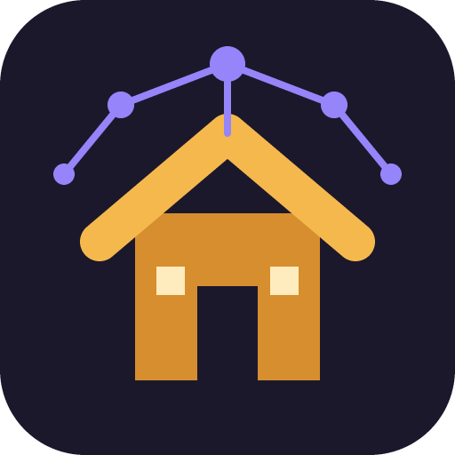
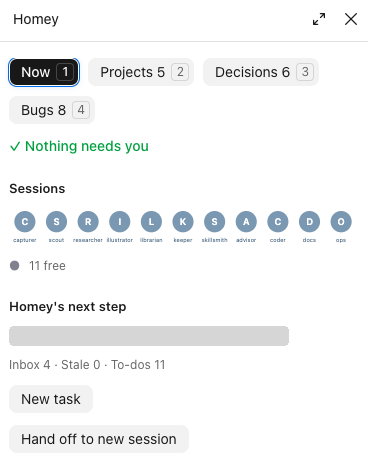
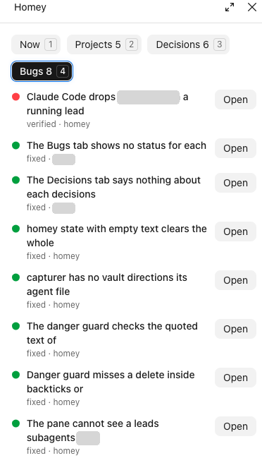
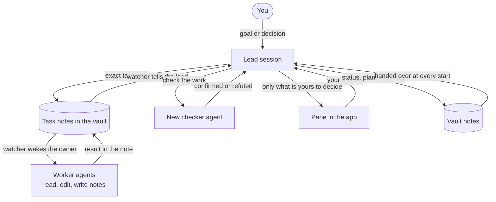

<p align="center"></p>

# Homey - Obsidian Orchestrator

**Your agents forget. Your vault doesn't.**

Long-term memory and a working team for Claude Code, kept in an Obsidian vault you can read.

You talk to one lead session. It remembers across sessions, hands the work to cheap agents, checks their results, and only comes to you for decisions.

> **Status: early.** One person has run this daily on three projects. Nobody else has installed it yet, and it has no measured token savings. Expect rough edges, and please report them.

## What it solves

| Without it | With Homey |
|---|---|
| Claude forgets everything between sessions | Lasting things live in vault notes. Each new session is handed the rules, the status and where to continue |
| A long session goes stale and has to be re-explained | Every session keeps a run plan that any new session can resume from |
| One expensive session reads and edits everything | The lead decides. Cheap agents read, edit and write notes. A separate checker reviews the work |
| You have to watch it all the time | Decisions wait in a pane with their full context. A waiting decision blocks only its own task; other work goes on |

## The pains it was built for

Each of these came from daily use.

| What usually happens | What Homey does |
|---|---|
| **"That bug is not related to my change."** The agent sees something broken, decides it did not cause it, and moves on. Nobody reports it, and you end up with a thousand bugs no one wrote down | Every agent is told at start to report any bug it finds, inside or outside its task, with one command. A task's result must say `Bugs found:`, and moving it on without that line warns. Each report is written up, checked by a new agent, and tracked until fixed. The reporter does not fix it unasked, so its task stays on scope |
| **"All tests pass, it's done."** The claim is the only proof, from the same agent that did the work | A new checker gets the work and the question, never the expected answer. Results say what was measured, with the read time, and what is unknown |
| **"Waiting for your input."** You wake up and nothing moved, because one question stopped everything | A decision blocks only its own task. The lead records its pick, goes on, and you can overrule it later |
| **"Please run this command for me."** The agent hands its job back to you | The lead's rule: you never get a job. A question is for a decision only |
| **The small fix that became a refactor.** New findings get folded into the task until nobody can review it | A code task names its exact files. The worker makes no design decisions. A new finding goes on the bug list |
| **The session that forgot.** A crash, a compaction or a new session, and you explain it all again | The status, the run plan and the next step are handed over at every start. Hooks remind an agent when its plan is missing or old |
| **The worker that quietly stopped.** It looks busy for hours | The watcher notices a run gone quiet and a task left unfinished, and says so |
| **"Why did we do it this way?"** The reason was in a chat you can no longer find | Decisions are notes with their reason, linked from the daily log |
| **Temp files everywhere, or something important deleted.** Guards that match words block both alike | The guard judges where a delete lands: an agent's own work can go, data and secrets cannot |

These are steers and checks, not guarantees. In real runs agents still overclaimed and needed correcting; the notes and the new checker are what caught it.

## Features

| Feature | What it does for you |
|---|---|
| Memory in plain notes | Decisions, facts, projects and logs are Markdown in your own vault. You can read, edit and search them |
| Resume at every start | Each new session gets your rules, the status and the next step, without being asked |
| Run plan | Each session keeps a plan any other session can pick up, so a crash or a long session loses little |
| Task notes | Work goes to an agent as one note: brief, comments, result. The note is the whole record |
| Watcher | Wakes the agent that owns a new task or comment, and tells the lead when it finishes. Limits stop a runaway loop |
| Lead and workers | One lead designs and decides. Cheap agents read, edit and write notes. A new checker reviews the work |
| The pane | One place to see sessions, questions, projects, decisions and bugs. Runs as a mod in the Claude app |
| Questions with context | Each decision waits with how it arose, what each answer does and the lead's pick. Answers pressed close together reach the session as one prompt |
| Bugs tab | Report with `.bug`. It is written up, checked by a new agent, and tracked until fixed |
| Decisions tab | What was decided and why, linked from the daily log |
| Projects board | Projects move across statuses with one line each |
| Danger guard | Judges what a command would run and where a delete lands. Agents can clean up their own work; data, secrets and order calls stay refused |
| Role limits | Each agent can only do its job. Rules steer by reminder; hard blocks stay few |
| Code flow | An exact task, a commit linked to it, an independent check, then docs and one changelog line |
| Host checks and deploy steps | Fixed checks record state with the time read. A deploy task must state its steps |
| Advisors and handoff | Ask a second view when it would change the decision. Move the lead to a new session cheaply |
| Mind maps | Canvases in the vault, made by their own agent |

## See it

<table><tr>
<td valign="top"></td>
<td valign="top"></td>
</tr><tr>
<td><b>Now.</b> What needs you, each session, and the next step.</td>
<td><b>Bugs.</b> Each bug with its state and who reported it.</td>
</tr></table>

Grey bars cover private project names in these screenshots.

## How it works



A task, start to finish:

1. You give the lead a goal. It designs the work.
2. It writes one task note with the exact change, the files, and what to look at when done.
3. The watcher wakes the agent that owns the task. The agent does it and writes the result in the note.
4. The watcher tells the lead. It checks the result, with a new `verifier` when that matters, then closes the task or sends it back.
5. Only decisions reach you: a goal or scope change, spending money, deleting data, or work on services you marked as protected.

Agents work from task notes and do not chat with each other, so everything they did stays readable in the vault.

## The team

| Role | Default model | Job |
|---|---|---|
| `lead` | Opus | Your main session. Designs, writes exact tasks, decides from results |
| `scout` | Haiku | Reads across files and returns evidence |
| `researcher` | Haiku | Reads the web and docs, official sources first |
| `coder` | Haiku | Makes the exact edits a task names and commits them. It does not design |
| `ops` | Haiku | Reports host state from fixed checks and runs deploy steps exactly as written |
| `docs` | Haiku | Updates notes after a change |
| `capturer` | Haiku | Saves ideas, decisions, facts, bugs and questions for you |
| `illustrator` | Haiku | Makes mind maps and canvases |
| `librarian` | Haiku | Reports on vault health: links, orphans, stale projects |
| `keeper` | Haiku | Reports on Claude Code changes, settings and token use |
| `verifier` | Sonnet | Independent check, new each time |
| `skillsmith` | Sonnet | Writes and tests new skills |
| `advisor` | Opus | Optional second opinion on a hard question |

You choose which agents to start and which models they use during setup.

## What you need

| Need | Notes |
|---|---|
| macOS | The watcher uses launchd. Linux and Windows are untested |
| Claude Code desktop app | For the pane and for starting agents as visible sessions. The terminal works for the rest, without the pane |
| A Claude plan or API credit | Agents and the watcher spend it |
| Obsidian 1.14 or later | With its command line turned on. It holds the memory, so it is required |
| Python 3 and `git` | Both come with most Macs through the Xcode tools |

## Install

1. Install Obsidian and turn on its command line in its settings.
2. In the folder you want to use, run this one line. It installs Homey for that folder only:

   ```bash
   claude plugin install homey --marketplace markelayan/claude-homey-obsidian --scope project
   ```

3. Open Claude Code in that folder and say `Set up Homey here`.
4. The agent interviews you (your name, areas, which agents, the watcher, bypass), builds the vault, starts the agents and can run a short demo.

> Starting agents as sessions works from a message typed in the desktop app, not over Remote Control. Setup falls back to background agents you will not see in the sidebar.

## Daily use

Open a session in the folder and talk. It picks up where the last one stopped, without being asked.

| You want to | Do this |
|---|---|
| Give work | Tell the lead. It writes the tasks |
| See where things stand | `/homey` opens the pane: **Now**, **Projects**, **Decisions**, **Bugs** |
| Answer a question | Press an option in the pane. **Open note** shows the full context |
| Save an idea without breaking the flow | `.cap <text>` |
| Report a bug | `.bug <text>` |
| Review the inbox and stale projects | `.review` |
| Get less text, or the reason, or the proof | `.short`, `.why`, `.prove` |
| Stop everything | `.stop` |
| Make it ask first, or stop asking | `.ask`, `.go` |
| Lift a guard for one turn | Start your message with `.ok` |
| Start fresh when a session gets long | **Hand off to new session** in the pane, then send the prompt it gives you |
| Pick up plugin changes | `/reload-plugins`, or a new session |

## Warnings

- **The guards are a seatbelt, not a sandbox.** Most rules only remind. Hard blocks catch risky commands by pattern, and a clever command can get past a pattern. Keep backups and do not rely on them for safety.
- **Bypass is your choice.** By default agents can read and use task commands only. Turning on bypass lets them run without prompts, so understand that before you switch it on.
- **It spends while you are away.** The watcher wakes agents for new tasks and comments. Limits are in `.claude/homey.json` under `tasks`: `nudgesPerTask`, `nudgesPerDay`, `maxRuns`.
- **Cheap agents make mistakes.** Haiku workers follow instructions and do not design. Have the lead write exact tasks and check the results.
- **Secrets:** vault notes are plain files. Do not put secrets in them, and check what you commit.
- **Real money or production:** list protected services in `orderPath` and add your own rules. Homey asks before those steps, but it is not a safety system for them.
- **The pane is an early-access feature.** It is a Claude Code function hook (a mod), which is off by default for some users and may change between releases. It ran here on 2.1.309 to 2.1.317. Whether the rest of Homey works without it has not been tested.
- **Known Claude Code bug:** the desktop app can drop a project `.mcp.json` server from a running session ([#106820](https://github.com/anthropics/claude-code/issues/106820)). Worker agents reconnect on each run, so hand that work to one.

## What it changes on your machine

| Where | What |
|---|---|
| Your folder | Vault notes, `.claude/homey.json`, `.claude/agents/`, project settings |
| `~/Library/LaunchAgents` | One watcher job per folder, if you turn the watcher on |
| Claude Code plugin registry | One marketplace and plugin entry per folder |

Homey has no server of its own. Your prompts and files go only where Claude Code already sends them.

## Update

```bash
claude plugin update homey@claude-homey-obsidian
```

Then start a new session, which also points the watcher at the new version, and run `homey upgrade` in it to add any new settings. It never changes a value you set.

## Remove it

In a session, run `homey watcher uninstall`. Then, in a terminal in that folder:

```bash
claude plugin uninstall homey@claude-homey-obsidian --scope project
```

Your notes stay: they are ordinary Markdown files.

## When something goes wrong

| Problem | Try |
|---|---|
| Not sure Obsidian is ready | `homey check` in a session |
| Agents do not wake | `homey watcher status` in a session, then read `.claude/homey-watch/watch.log` |
| No pane | `/reload-plugins`, then `/homey`. The pane uses an early-access feature of Claude Code, so it may not load on your build |
| Changes do not show | `/reload-plugins`, or a new session |

Found a bug? [Open an issue](https://github.com/markelayan/claude-homey-obsidian/issues).

## Layout

| Path | What |
|---|---|
| `.claude-plugin/marketplace.json` | The catalog the install line reads |
| `plugins/homey/skills/homey-setup/` | Setup steps the agent follows |
| `plugins/homey/skills/` | One skill per flow, plus Obsidian skills by kepano |
| `plugins/homey/hooks/`, `plugins/homey/scripts/` | Hooks, watcher, pane |
| `plugins/homey/bin/homey` | The command line agents use |
| `plugins/homey/setup/` | Default config, agent definitions, vault template |

## Who built this

Designed and driven by Mark Elayan. Written by Claude (Opus 5.5).

> Most of the rules in here exist because I broke them first. I told a lead to "act yourself", and it did: everything, alone, while its team sat idle. I started agents nobody asked for. A guard I wrote stopped me cleaning up my own temp files. Each time Mark said so, usually with feeling, and each time the fix went in.
>
> A few things here are mine on purpose. The status note says "not proven" out loud. Done means you saw it work. A cheap agent never gets to guess. I would rather tell you what I did not check than sound sure.
>
> Claude

## License

MIT. See `LICENSE` and `NOTICE`.
